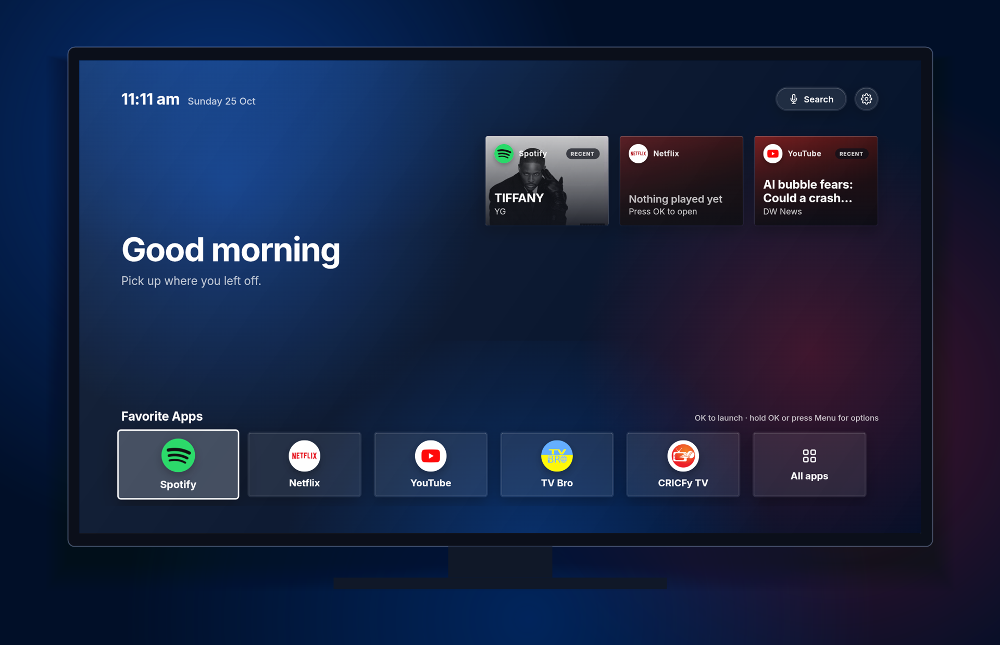
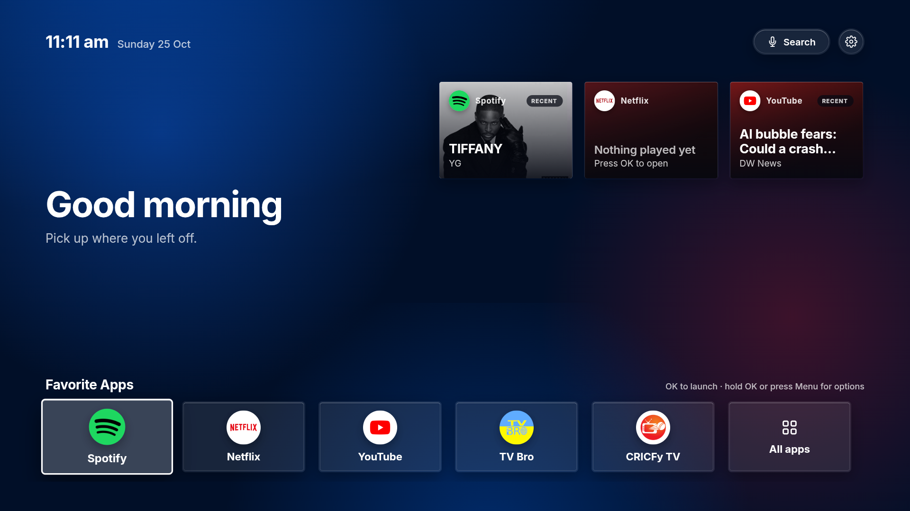
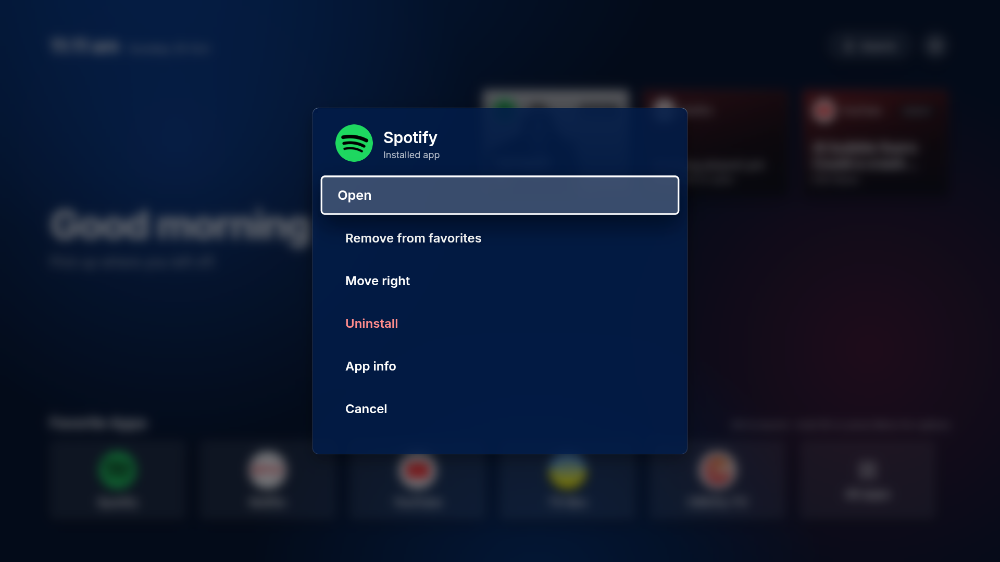
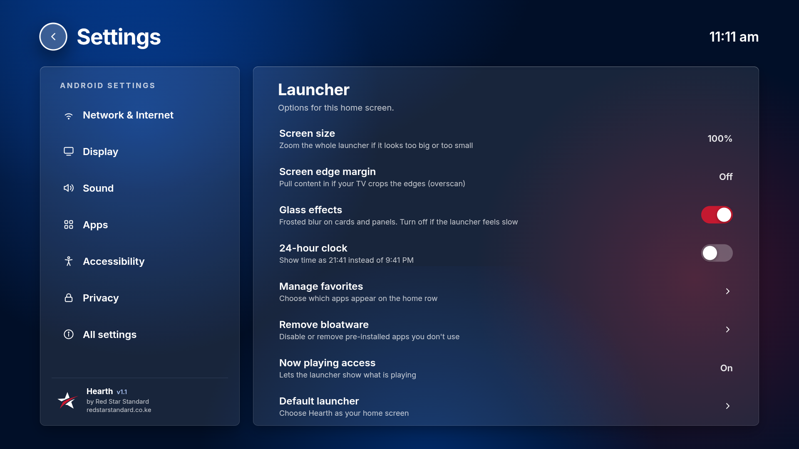
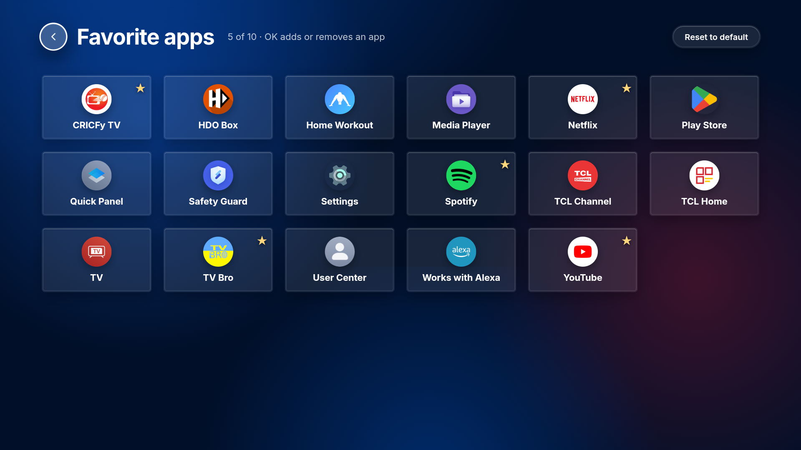

<div align="center">

# Hearth

**A fast, frosted-glass home screen for Android TV and Google TV.**  
*A [Red Star Standard](https://redstarstandard.co.ke) product.*

[](https://github.com/octocatblain/glass-tv-launcher/raw/main/dist/Hearth.apk)




</div>

> **Direct link:** [`dist/Hearth.apk`](dist/Hearth.apk) (about 850 KB). This is a debug-signed build for sideloading; it is not on the Play Store.

## Features

- **Red Star Standard design**: navy and red brand palette, Inter typeface, frosted glass surfaces over soft colour glows, and a white-and-red focus ring that is easy to follow from the sofa. A **Glass effects** switch turns the blur off if your TV is slow.
- **Favorite apps row**: your most-used apps as round icons. Add, remove and reorder them from **Settings → Manage favorites** or with the options menu on any app.
- **Now-playing cards**: Spotify, Netflix and YouTube show what is playing or paused, with cover art. When nothing is playing, each card keeps showing the **last thing you played** in that app.
- **All apps** grid and **Pre-installed apps** screen for finding and removing bloatware.
- **App options menu**: press **Menu**/**Info**, or hold **OK**, on any app to open, add or remove it from favorites, move it, uninstall or disable it, or open its App info.
- **Settings**: shortcuts to Android's Network, Display, Sound, Apps, Accessibility and Privacy screens, plus launcher options (screen size, edge margin for overscan, glass effects, 24-hour clock).
- **Voice search** button and remote Search key.
- No third-party libraries: Kotlin plus a WebView that renders the HTML/CSS/JS UI in `assets/`.

## Screenshots

| Home | App options |
| :---: | :---: |
|  |  |
| **Settings** | **Manage favorites** |
|  |  |

## Installation

You need an Android TV or Google TV device on Android 7.0 or newer. Pick one method.

### Option A: on the TV with the Downloader app (no computer)

1. Install **Downloader** (by AFTVnews) from the Play Store or Google Play on your TV.
2. Allow it to install unknown apps: **Settings → Apps → Security & restrictions → Unknown sources → Downloader** (the path varies by TV brand).
3. Open Downloader and enter this address:
   `https://github.com/octocatblain/glass-tv-launcher/raw/main/dist/Hearth.apk`
4. When the download finishes, choose **Install**, then **Open**.

### Option B: over ADB from a computer

1. On the TV: **Settings → System → About**, click **Build** seven times to enable Developer options.
2. **Settings → System → Developer options**: turn on **USB debugging** (or **Network/Wireless debugging**).
3. Install [Android platform tools](https://developer.android.com/tools/releases/platform-tools), then:

   ```bash
   adb connect <tv-ip-address>:5555      # skip this if connected by USB
   adb install -r dist/Hearth.apk
   ```

### Option C: USB drive

Copy `dist/Hearth.apk` to a USB drive, plug it into the TV, open it with a file manager app (for example **File Commander** or **X-plore**) and install it.

## Make it your home screen

1. Open **Hearth** once. It offers to become your default home app. Choose **Hearth** and **Always**.
2. If no prompt appears, use **Settings → Default launcher** inside the launcher, or Android's **Settings → Apps → Default apps → Home app**.
3. Still opening the stock screen? Many TVs insist on their own launcher. From a computer with ADB:

   ```bash
   adb shell cmd role add-role-holder --user 0 android.app.role.HOME com.glasstv.launcher
   adb shell cmd package set-home-activity com.glasstv.launcher/.MainActivity
   ```

4. Last resort, riskier: disable the stock launcher. Keep ADB access working so you can undo it.

   ```bash
   # Google TV
   adb shell pm disable-user --user 0 com.google.android.apps.tv.launcherx
   # some builds also fall back to a setup-recovery screen when Home is pressed
   adb shell pm disable-user --user 0 com.google.android.tungsten.setupwraith
   # undo
   adb shell pm enable com.google.android.apps.tv.launcherx
   adb shell pm enable com.google.android.tungsten.setupwraith
   ```

   Older Android TV builds use `com.google.android.tvlauncher` instead.

## Turn on now-playing cards

Android only shares what is playing with apps you allow.

- In the launcher: **Settings → Now playing access**, then enable Hearth; or
- Over ADB, which also works around the "restricted setting" block on Android 13+:

  ```bash
  adb shell cmd notification allow_listener com.glasstv.launcher/com.glasstv.launcher.MediaListener
  ```

The service never reads your notifications; it only exists to unlock media sessions.

## Using it

| Remote | Action |
| --- | --- |
| **D-pad** | Move between apps and settings |
| **OK** | Open the selected app or setting |
| **Hold OK** or **Menu / Info** | App options: open, favorite, move, uninstall or disable, app info |
| **Back** | Close a menu or go back to Home |
| **Search / voice button** | Voice search |

## Removing bloatware and uninstalling apps

- **Apps you installed**: open the options menu and choose **Uninstall**.
- **Pre-installed apps**: Android does not let a normal app delete these. **Settings → Remove bloatware** lists them, and the menu opens each app's App info page where you can choose **Disable**. To remove one for your user from a computer:

  ```bash
  adb shell pm uninstall -k --user 0 <package.name>
  # restore it later
  adb shell cmd package install-existing <package.name>
  ```

- Core apps (Settings, Play Store, the TV input and system services) are hidden from that list because removing them can break the TV.

## Customizing

Edit `app/src/main/assets/config.js`, then rebuild:

```js
window.CONFIG = {
  pinned: ["com.spotify.tv.android", "com.netflix.ninja", /* ... */], // shown first, in this order
  homeRowCount: 5                                                      // favorites when you have not edited them
};
```

Your own favorites, edited in the launcher, take priority over `pinned`. Other files: `style.css` (look and layout on a fixed 1920×1080 stage that scales to your screen), `app.js` (behaviour and navigation), `LauncherBridge.kt` (apps, launching, uninstalling, media sessions).

**Preview without a TV**: open `app/src/main/assets/index.html` in Chrome and use the arrow keys, Enter and Esc. It uses demo data when it is not running inside the app.

## Build from source

Requirements: Android Studio (or JDK 17 and the Android SDK).

```bash
git clone https://github.com/octocatblain/glass-tv-launcher.git
cd glass-tv-launcher
./gradlew assembleDebug        # Windows: gradlew.bat assembleDebug
```

If Gradle says `JAVA_HOME` is not set, point it at a JDK 17+, for example Android Studio's bundled one (`<Android Studio>/jbr`).

The APK is written to `app/build/outputs/apk/debug/app-debug.apk` and **copied to `dist/Hearth.apk`** after every debug build, so the download link above always matches your latest build.

## Project structure

```
glass-tv-launcher/
├── dist/
│   └── Hearth.apk          ← ready-to-install APK (updated by every build)
├── docs/
│   ├── mockup.png                 ← hero image used in this README
│   └── screenshots/               ← real screenshots from a TV
├── app/
│   ├── build.gradle.kts           ← app config; also copies the APK to dist/
│   └── src/main/
│       ├── AndroidManifest.xml    ← home + TV launcher intents, permissions
│       ├── assets/                ← the whole UI
│       │   ├── index.html         ← screens: home, all apps, favorites, bloatware, settings, options sheet
│       │   ├── style.css          ← glass styling and layout
│       │   ├── app.js             ← navigation, favorites, now-playing cards, settings
│       │   ├── config.js          ← pinned apps and row size
│       │   ├── fonts/             ← Inter (variable), SIL OFL
│       │   └── img/logo-mark.svg  ← Red Star Standard mark
│       ├── java/com/glasstv/launcher/
│       │   ├── MainActivity.kt    ← WebView host, remote keys, default-launcher request
│       │   ├── LauncherBridge.kt  ← app list, launch, uninstall, media sessions, settings shortcuts
│       │   └── MediaListener.kt   ← notification listener that unlocks media sessions
│       └── res/                   ← app icon, TV banner, theme, colours
├── build.gradle.kts · settings.gradle.kts · gradle/ · gradlew(.bat)
└── README.md
```

## About Red Star Standard

Hearth is built and maintained by [Red Star Standard](https://redstarstandard.co.ke), an AI consultancy and AI-driven software team. Product page and downloads: <https://redstarstandard.co.ke/tv-launcher>. Support and custom builds: consultancy@redstarstandard.co.ke.

The interface follows the Red Star Standard brand system: brand navy `#013480`, action red `#C41930`, the Inter typeface and the star mark. The Inter font is licensed under the SIL Open Font License (`app/src/main/assets/fonts/OFL.txt`).

## Known limits

- The APK is **debug-signed**, so it installs by sideloading only. To update, install the newer APK over it (`adb install -r`); it keeps your settings.
- Android only exposes the item that is *currently active* in an app. The now-playing cards therefore remember the last thing the launcher saw. They cannot show watch history or "continue watching" rows, and opening a card opens the app, not the specific song or video.
- Glass blur can be heavy on budget TV hardware. If it feels slow, switch off **Settings → Glass effects**.
- The Google TV recommendations and Watch Next feed are not included.
