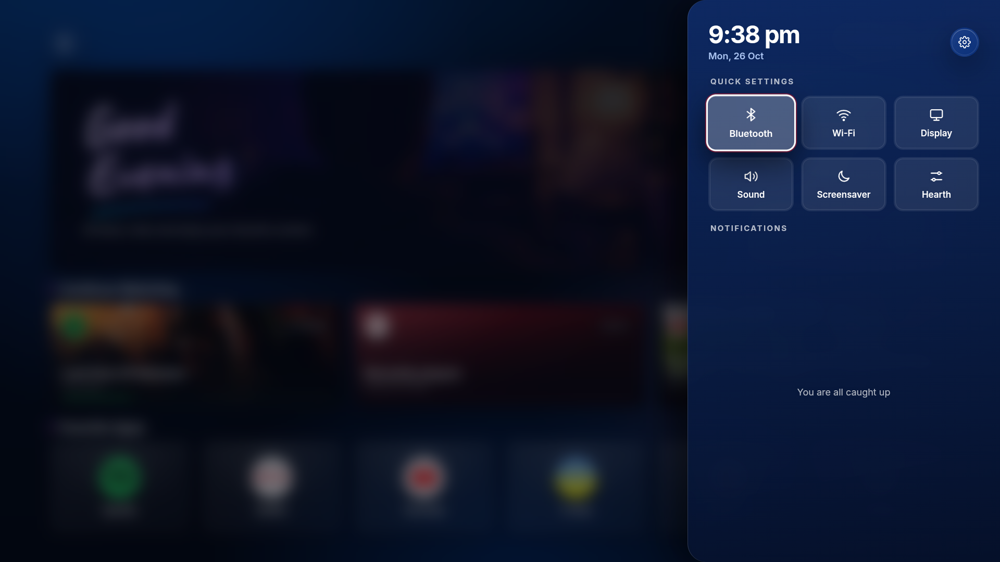
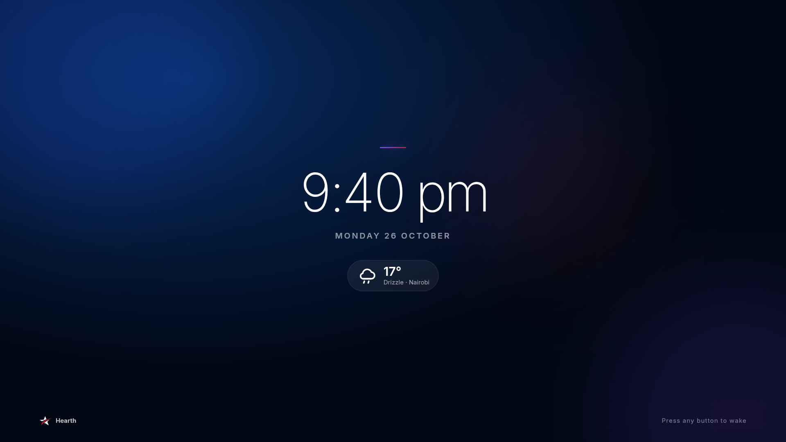

<div align="center">

# Hearth

**A fast, frosted-glass home screen for Android TV and Google TV.**  
*A [Red Star Standard](https://redstarstandard.co.ke) product.*

[](https://github.com/octocatblain/glass-tv-launcher/raw/main/dist/Hearth.apk)
[](https://github.com/octocatblain/glass-tv-launcher/releases)


</div>

> **Download count:** the badge above is the total number of times the APK has been downloaded from this repository's [Releases](https://github.com/octocatblain/glass-tv-launcher/releases) page (GitHub counts release assets only). Attach `dist/Hearth.apk` to a release to start counting.
>
> **Direct link:** [`dist/Hearth.apk`](dist/Hearth.apk) (about 1.1 MB). This is a debug-signed build for sideloading; it is not on the Play Store.

## Features

### Home screen
- **Cinematic hero**: a photo backdrop that changes with the **time of day** (morning, afternoon, evening, night), with a handwritten **Good Evening**-style greeting and a blue swoosh underline.
- **Clock and date** at the top right, with the settings button beside them, and a **voice search** mic at the top left.
- **Weather card**: current condition and temperature plus the next two hours, from Open-Meteo. The location comes from the TV's public IP address, or can be pinned in `config.js`.
- **Continue Watching** cards for **Spotify, Netflix and YouTube**: title, cover art and a progress bar where the app exposes it, with a Playing, Paused or Recent badge. When a session ends, the card keeps the last thing seen.
- **Favorite Apps row**: round icons you choose, add, remove and reorder from **Settings → Manage favorites** or the app options menu.

### Quick settings sidebar
- Press the remote's **Settings** button to slide in a sidebar with the date and time, a **gear** for Android's full settings, and one-press tiles for **Bluetooth, Wi-Fi, Display, Sound and Screensaver**, plus a **Hearth** tile for the launcher's own settings. **Menu** opens the same sidebar on any TV.
- It works **over other apps**: press Settings inside Spotify or YouTube and the sidebar appears on top of that app, which stays visible behind it. Press Settings again, or Back, to close it.
- A **Notifications** section lists recent notifications from other apps. Press OK on one to open its app and dismiss it, or choose **Clear all**. It needs Now playing access (see below).
- Over other apps this needs a one-time setup on some TVs, see [Settings button](#settings-button).



### Always-on behaviour
- **Stays awake for music**: while media is playing, the launcher keeps the TV's screensaver away. The TV only counts as idle after **nothing has played and the remote has been untouched for 15 minutes** (configurable).
- **Ambient screen saver**: a slowly drifting clock-and-weather screen that keeps the display on. Any remote button wakes it.

### Apps and settings
- **All apps** grid, a **Pre-installed apps** screen for finding and removing bloatware, and an **app options** menu (open, favorite, move, uninstall or disable, app info).
- **Launcher settings**: screen size, edge margin for overscan, glass effects switch, 24-hour clock, screen saver switch, plus shortcuts to Network, Display, Sound, Apps, Accessibility and Privacy.
- **Red Star Standard design**: navy and red palette with a violet accent, **Inter** and **Caveat** typefaces, frosted glass over soft colour glows, and a white-and-red focus ring that is easy to follow from the sofa.
- No third-party libraries: Kotlin plus a WebView that renders the HTML/CSS/JS UI in `assets/`.

## Screenshots

| Home | Quick settings |
| :---: | :---: |
|  |  |
| **Settings** | **Manage favorites** |
|  |  |
| **App options** | **Screen saver** |
|  |  |

## Installation

You need an Android TV or Google TV device on Android 7.0 or newer. Pick one method.

### Option A: on the TV with the Downloader app (no computer)

1. Install **Downloader** (by AFTVnews) from the Play Store or Google Play on your TV.
2. Allow it to install unknown apps: **Settings → Apps → Security & restrictions → Unknown sources → Downloader** (the path varies by TV brand).
3. Open Downloader and enter this address:
   `https://github.com/octocatblain/glass-tv-launcher/raw/main/dist/Hearth.apk`
4. When the download finishes, choose **Install**, then **Open**.

### Option B: over ADB from a computer

1. On the TV: **Settings → System → About**, click **Build** seven times to enable Developer options.
2. **Settings → System → Developer options**: turn on **USB debugging** (or **Network/Wireless debugging**).
3. Install [Android platform tools](https://developer.android.com/tools/releases/platform-tools), then:

   ```bash
   adb connect <tv-ip-address>:5555      # skip this if connected by USB
   adb install -r dist/Hearth.apk
   ```

### Option C: USB drive

Copy `dist/Hearth.apk` to a USB drive, plug it into the TV, open it with a file manager app (for example **File Commander** or **X-plore**) and install it.

## Make it your home screen

1. Open **Hearth** once. It offers to become your default home app. Choose **Hearth** and **Always**.
2. If no prompt appears, use **Settings → Default launcher** inside the launcher, or Android's **Settings → Apps → Default apps → Home app**.
3. Still opening the stock screen? Many TVs insist on their own launcher. From a computer with ADB:

   ```bash
   adb shell cmd role add-role-holder --user 0 android.app.role.HOME com.glasstv.launcher
   adb shell cmd package set-home-activity com.glasstv.launcher/.MainActivity
   ```

4. Last resort, riskier: disable the stock launcher. Keep ADB access working so you can undo it.

   ```bash
   # Google TV
   adb shell pm disable-user --user 0 com.google.android.apps.tv.launcherx
   # some builds also fall back to a setup-recovery screen when Home is pressed
   adb shell pm disable-user --user 0 com.google.android.tungsten.setupwraith
   # undo
   adb shell pm enable com.google.android.apps.tv.launcherx
   adb shell pm enable com.google.android.tungsten.setupwraith
   ```

   Older Android TV builds use `com.google.android.tvlauncher` instead.

## Turn on now-playing cards

Android only shares what is playing with apps you allow.

- In the launcher: **Settings → Now playing access**, then enable Hearth; or
- Over ADB, which also works around the "restricted setting" block on Android 13+:

  ```bash
  adb shell cmd notification allow_listener com.glasstv.launcher/com.glasstv.launcher.MediaListener
  ```

The service never reads your notifications; it only exists to unlock media sessions.

## Settings button

Inside the launcher, **Menu** and the remote's Settings button open the quick settings sidebar by themselves. On many TVs they do not reach the launcher while another app is open, and some firmware (TCL, for one) launches its own Settings app, or ignores the key. Hearth ships a small accessibility service, **Hearth Settings key**, that fills the gap:

- it catches the button's key code (`KEYCODE_NOTIFICATION` on TCL remotes) before the app in front gets it, and opens or closes the sidebar;
- if the TV launches its own Settings app instead (`KEYCODE_SETTINGS`), it closes that and opens the sidebar. Settings screens opened from Hearth's own buttons are left alone;
- it reads no screen content, only which app's window opened and the one key.

### Turn it on

1. In the launcher: **Settings → Settings button shortcut** (opens Android's Accessibility settings), then turn on **Hearth Settings key** and accept the key-observation prompt.
2. **After every update of the APK, switch it off and on once.** Android keeps it listed as enabled but stops running it when the app is replaced.

### TCL and other TVs that block background apps

TCL's firmware refuses to start accessibility services for apps without the "auto start" permission, so the toggle stays on **Off** and the log says `forbid bind service … OP_AUTO_START`. Allow it once from a computer, then switch the service off and on:

```bash
adb shell appops set com.glasstv.launcher APP_AUTO_START allow
```

Without the service, the **Menu** key and the in-launcher gear still open the sidebar on the home screen.

## Using it

| Remote | Action |
| --- | --- |
| **D-pad** | Move between apps and settings |
| **OK** | Open the selected app or setting |
| **Settings** (or **Menu**) | Quick settings sidebar. Press again to close it |
| **Hold OK** on an app | App options: open, favorite, move, uninstall or disable, app info |
| **Back** | Close a menu or go back to Home |
| **Search / voice button** | Voice search |

## Removing bloatware and uninstalling apps

- **Apps you installed**: open the options menu and choose **Uninstall**.
- **Pre-installed apps**: Android does not let a normal app delete these. **Settings → Remove bloatware** lists them, and the menu opens each app's App info page where you can choose **Disable**. To remove one for your user from a computer:

  ```bash
  adb shell pm uninstall -k --user 0 <package.name>
  # restore it later
  adb shell cmd package install-existing <package.name>
  ```

- Core apps (Settings, Play Store, the TV input and system services) are hidden from that list because removing them can break the TV.

## Weather, idling and the screen saver

The weather card at the top right shows the **current hour and the next two hours**: a large current condition with temperature, then the hour-by-hour strip. The current hour's strip cell is subtly highlighted. Weather comes from [Open-Meteo](https://open-meteo.com/) and needs an internet connection but no API key. The launcher finds the TV's rough position from its public IP address; to pin a location instead, set `weather.lat`/`weather.lon` in `config.js`.

The launcher stays awake while music or other media is playing, even if nobody touches the remote and the Home screen is just sitting there. Concretely:

- **Music playing** → the launcher holds the screen on, so the Google TV screensaver/Daydream no longer covers the Home screen mid-song.
- **No music and no remote input for 15 minutes** → the launcher is idle. With **Settings → Screen saver** on (the default), the ambient screen saver fades in and keeps the display on. With it off, the launcher releases the screen and the TV can dim, dream or sleep normally.
- Any remote key or touch dismisses the screen saver; the 15 minutes start when the music stops, not when the last button was pressed.
- Music detection uses Android's music audio stream, so it works without **Now playing access**. Change the timeout with `idleMinutes` in `config.js`.


## Customizing

Edit `app/src/main/assets/config.js`, then rebuild:

```js
window.CONFIG = {
  pinned: ["com.spotify.tv.android", "com.netflix.ninja", /* ... */], // shown first, in this order
  homeRowCount: 5,      // favorites when you have not edited them

  idleMinutes: 15,      // no music + no remote input for this long before idle/ambient saver

  weather: {
    lat: null,          // null: locate the TV by its public IP address
    lon: null,          // or set lat/lon to pin a location, e.g. -1.2921 / 36.8219
    place: "",          // label in the weather card, e.g. "Nairobi"; blank uses the detected city
    units: "c"          // "c" for Celsius, "f" for Fahrenheit
  }
};
```

Your own favorites, edited in the launcher, take priority over `pinned`. The screen saver is toggled in **Settings → Screen saver**; `idleMinutes` controls when it appears. Other files: `style.css` (look and layout on a fixed 1920×1080 stage that scales to your screen), `app.js` (behaviour, navigation, media cards, weather and ambient saver UI), `LauncherBridge.kt` (apps, launching, uninstalling, media sessions), `Weather.kt` (forecast and IP lookup) and `IdleController.kt` (idle detection and screen-saver timing).

**Preview without a TV**: open `app/src/main/assets/index.html` in Chrome and use the arrow keys, Enter and Esc. It uses demo data when it is not running inside the app.

## Build from source

Requirements: Android Studio (or JDK 17 and the Android SDK).

```bash
git clone https://github.com/octocatblain/glass-tv-launcher.git
cd glass-tv-launcher
./gradlew assembleDebug        # Windows: gradlew.bat assembleDebug
```

If Gradle says `JAVA_HOME` is not set, point it at a JDK 17+, for example Android Studio's bundled one (`<Android Studio>/jbr`).

The APK is written to `app/build/outputs/apk/debug/app-debug.apk` and **copied to `dist/Hearth.apk`** after every debug build, so the download link above always matches your latest build.

## Project structure

```
glass-tv-launcher/
├── dist/
│   └── Hearth.apk          ← ready-to-install APK (updated by every build)
├── docs/
│   ├── mockup.png                 ← hero image used in this README
│   └── screenshots/               ← real screenshots from a TV
├── app/
│   ├── build.gradle.kts           ← app config; also copies the APK to dist/
│   └── src/main/
│       ├── AndroidManifest.xml    ← home + TV launcher intents, permissions
│       ├── assets/                ← the whole UI
│       │   ├── index.html         ← screens: home, all apps, favorites, bloatware, settings, options sheet, saver
│       │   ├── style.css          ← glass styling, cinematic hero, weather card and ambient saver
│       │   ├── app.js             ← navigation, favorites, media cards, weather, saver, settings
│       │   ├── config.js          ← pinned apps, row size, idle timeout, weather
│       │   ├── fonts/             ← Inter + Caveat, SIL OFL
│       │   └── img/               ← logo mark and time-of-day hero photographs
│       ├── java/com/glasstv/launcher/
│       │   ├── MainActivity.kt    ← WebView host, remote keys, default-launcher request
│       │   ├── LauncherBridge.kt  ← app list, launch, uninstall, media sessions, settings shortcuts
│       │   ├── IdleController.kt  ← music-aware idle detection and ambient screen-saver timing
│       │   ├── Weather.kt         ← IP location + Open-Meteo hourly forecast
│       │   ├── QuickSettingsActivity.kt ← see-through sidebar shown over other apps
│       │   ├── JsHost.kt          ← lets the bridge talk to either web activity
│       │   ├── MediaListener.kt   ← notification listener: media sessions and sidebar notifications
│       │   └── KeyService.kt      ← accessibility service that catches the remote's Settings button
│       └── res/                   ← app icon, TV banner, theme, colours
├── build.gradle.kts · settings.gradle.kts · gradle/ · gradlew(.bat)
└── README.md
```

## About Red Star Standard

Hearth is built and maintained by [Red Star Standard](https://redstarstandard.co.ke), an AI consultancy and AI-driven software team. Product page and downloads: <https://redstarstandard.co.ke/tv-launcher>. Support and custom builds: consultancy@redstarstandard.co.ke.

The interface follows the Red Star Standard brand system: brand navy `#013480`, action red `#C41930`, an evening violet accent, the Inter and Caveat typefaces, and the star mark. Inter is licensed under the SIL Open Font License (`app/src/main/assets/fonts/OFL.txt`); Caveat is licensed under the SIL Open Font License (`app/src/main/assets/fonts/OFL-Caveat.txt`). The hero photograph is the supplied product reference artwork.

## Known limits

- The APK is **debug-signed**, so it installs by sideloading only. To update, install the newer APK over it (`adb install -r`); it keeps your settings.
- Android only exposes the item that is *currently active* in an app. The Continue Watching cards therefore remember the last thing the launcher saw. They cannot show a complete watch history, and opening a card opens the app, not the specific song or video.
- **Netflix** (tested with 13.2.1 on Android TV) publishes a media session with a playback state but **no title or artwork**, and Android gives no app access to your Netflix account or its profiles (for example "blain"), so the launcher cannot read your watch history. Where the TV publishes a **Watch Next** row (Google TV home), the Netflix card shows the latest entry from it; otherwise it shows "Playing/Paused on Netflix" or "Recently played". Spotify and YouTube expose full metadata.
- The sidebar over other apps is dimmed rather than blurred, because a see-through window cannot blur another app, and the app behind it is paused while it is open.
- Keys injected over ADB (`adb shell input keyevent`) do not reach accessibility services, so the Settings-button shortcut can only be tested with the real remote.
- The notification list shows only what other apps currently have posted, skips ongoing background-service notices, and needs Now playing access.
- Glass blur can be heavy on budget TV hardware. If it feels slow, switch off **Settings → Glass effects**.
- Weather needs an internet connection. IP-based location is approximate (usually the city), so pin `weather.lat`/`weather.lon` if the forecast is for the wrong place. No API key is needed.
- The ambient screen saver keeps the display on while it is showing. If you would rather let the TV dim or sleep after 15 idle minutes, turn **Settings → Screen saver** off.
- The awake logic keeps Hearth's own window on while media is playing on the music stream. When you open another app, that app owns the screen and its own keep-awake behaviour.
- The Google TV recommendations and Watch Next feed are not included.
